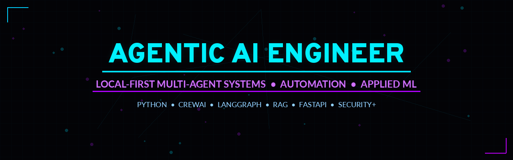

# Daniel Lee Barren

**Agentic systems · AI data engineering · applied ML**  
Columbus, OH · open to senior full-time or contract · remote or Midwest hybrid

[dannybarren.com](https://dannybarren.com) · [GitHub](https://github.com/DannyBarren) · [LinkedIn](https://www.linkedin.com/in/danny-barren) · dan@dannybarren.com

I build **local-first, approval-gated agent systems** and the data/ML pipelines around them. Python-first. Production UIs. Human review before anything irreversible. No vendor lock-in.

Former **JPMorgan Chase** (Nov 2022 – May 2026), where I automated multi-day analytics and document workflows down to under an hour. Founder of **Barren Business Development**. Ohio Army National Guard veteran (ETS Oct 2026). MBA in Statistics & Analytics in progress at Wilmington University.

## Focus

- **Agentic systems** — LangGraph, LangChain, CrewAI; tool-calling operators; approval gates; cost caps; local RAG
- **AI data engineering** — PDF → validated JSON, structured extraction, audit trails, evals that run without live APIs
- **Applied ML for operations** — ledger coding, stacked classifiers, review queues that never overwrite ground truth

## Flagship work

| Project | What it is |
| --- | --- |
| [primus](https://github.com/DannyBarren/primus) | Local LangGraph desktop operator for files, mail, and shell. ~120 tools packed by intent. Destructive commands wait for approval. |
| [NightForge-LeadForge](https://github.com/DannyBarren/NightForge-LeadForge) | Overnight lead-gen pipeline with a hard spend cap, human review on every row, and no send path. |
| [WordPressGenius](https://github.com/DannyBarren/WordPressGenius) | LangGraph WordPress / WooCommerce operator. Drafts are free; publishes, deletes, and refunds wait for approval and a JSON backup. |
| [PrivaGen-Anonymizer](https://github.com/DannyBarren/PrivaGen-Anonymizer) | GPU-first image anonymizer: faces, on-image text, EXIF strip, per-file JSON audit. Originals never written. Automatic CPU fallback. |
| [Code_Down_ML](https://github.com/DannyBarren/Code_Down_ML) | Ledger auto-fill: rules → memory → TF-IDF → LogReg (SetFit optional). Review queue. Existing codes never overwritten. |
| [PDF_to_JSON](https://github.com/DannyBarren/PDF_to_JSON) | Trades PDF → validated JobDoc `ReportTemplate` JSON (schema v3). FastAPI + CLI. The pipeline never returns an invalid template. |
| [report_automation](https://github.com/DannyBarren/report_automation) (JobDoc) | Narrated field walkthrough → structured PDF report. Speech-to-text, writing agent, WeasyPrint. |

## Stack

**Agents:** LangGraph, LangChain, CrewAI, Ollama, tool packs, approval queues  
**Services:** Python, FastAPI, Streamlit, Gradio, Flask, Pydantic v2, Docker  
**Data / ML:** Pandas, scikit-learn, TF-IDF / LogReg / SetFit, PyMuPDF, WeasyPrint  
**Safety:** pytest, eval cases, encrypted credential vaults, audit logs, budget governors

Caltech AI/ML Programming (2025) · CompTIA Security+ · Secret clearance

## Contact

**dan@dannybarren.com** · [dannybarren.com](https://dannybarren.com) · [LinkedIn](https://www.linkedin.com/in/danny-barren) · [github.com/DannyBarren](https://github.com/DannyBarren)
